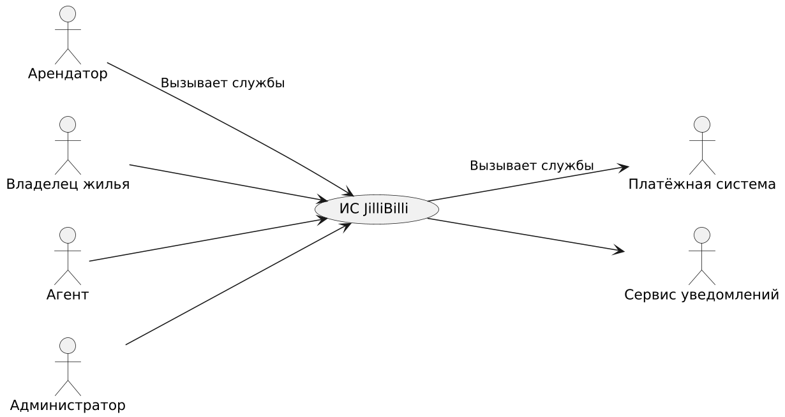

## Введение
Нам видится надежная информационная система жилищного агентства JilliBilli, которая автоматизирует весь путь аренды жилья: публикацию предложений владельцами, подбор жилья арендаторами, подачу и рассмотрение заявок, оформление договора, оплату и расчет комиссии агентства. Система должна гибко поддерживать бизнес-правила агентства и интегрироваться с внешними системами: платежной системой и сервисом уведомлений. 
Анализ в этом примере носит учебный характер. 

## Позиционирование

### Экономические предпосылки 
Многие агентства до сих пор ведут учет предложений и сделок в таблицах, мессенджерах и на бумаге. Такие средства не масштабируются, не дают единого актуального каталога, не защищают от двойной сдачи одного и того же жилья и не позволяют быстро подобрать вариант по набору критериев. Универсальные доски объявлений не учитывают роль агентства: проверку документов, оформление договора и расчет комиссии. Кроме того, существующие решения плохо интегрируются с платежными системами и не позволяют гибко менять тарифы агентства. Это открывает нишу для специализированной информационной системы.

### Формулировка проблемы 
Ручной учет приводит к устаревшим объявлениям, потере заявок, ошибкам в договорах и расчетах комиссии, а также к долгому подбору жилья. Эти проблемы касаются арендаторов, владельцев жилья, агентов и руководства агентства JilliBilli.

### Место системы 
Система предназначена для сотрудников агентства JilliBilli, арендаторов и владельцев жилья. В отличие от обычных досок объявлений она включает обязательную проверку объекта агентом, учет заявок и просмотров, электронное оформление договора, автоматический расчет комиссии и выплаты владельцам через платежную систему.

## Заинтересованные лица 
Демографические особенности рынка: основные клиенты агентства — жители города, ищущие жилье в аренду (студенты, молодые семьи, работающие специалисты), и собственники жилья, желающие сдавать его через посредника. 

Заинтересованные лица, не являющиеся пользователями системы: руководство агентства, бухгалтерия агентства, налоговые органы. 

Пользователи системы: арендаторы, владельцы жилья, агенты, администраторы. 

### Основные задачи высокого уровня и проблемы заинтересованных лиц 

| Цель высокого уровня | Приоритет | Проблемы и замечания | Текущие решения |
|---|---|---|---|
| Быстрый и точный подбор жилья | Высокий | Объявления разбросаны по разным источникам, часть из них устарела. Сложно отфильтровать варианты по цене, району, числу комнат | Общие доски объявлений, переписка с агентами |
| Надежное оформление сделки | Высокий | Ошибки в договорах, двойная сдача одного объекта, отсутствие проверки документов на жилье | Бумажные договоры, ручная проверка |
| Прозрачный учет платежей и комиссии | Высокий | Комиссия считается вручную, выплаты владельцам задерживаются, нет единой истории платежей | Таблицы, банковские переводы |
| Актуальный каталог предложений | Средний | Владелец не может быстро снять объект с предложения, сданные квартиры остаются в списке | Ручное обновление списка |
| Своевременное информирование участников сделки | Средний | Арендатор и владелец не знают о новых заявках, решениях и платежах | Звонки и сообщения в мессенджерах |
| Гибкая настройка тарифов и правил агентства | Средний | При смене условий комиссию и правила приходится менять вручную в каждом документе | Таблицы с тарифами |

### Задачи уровня пользователя 

Пользователи (и внешние системы) используют данную систему в таких целях. 

 - Арендатор. Подбирает жилье, подает заявку на аренду, записывается на просмотр, подписывает договор и оплачивает аренду. 
 - Владелец жилья. Предлагает жилье, снимает его с предложения, рассматривает заявки, подписывает договор и получает выплату. 
 - Агент. Проверяет объекты и документы, оформляет и расторгает договоры, рассчитывает комиссию. 
 - Администратор. Управляет пользователями, справочниками и правами доступа. 
 - Платежная система. Принимает платежи арендаторов и выполняет выплаты владельцам. 
 - Сервис уведомлений. Рассылает участникам сделки сообщения о новых заявках и изменении их статуса. 

## Обзор

### Перспективы продукта 

Система JilliBilli работает как веб-приложение в офисе агентства и доступна клиентам через интернет. Она обслуживает пользователей и взаимодействует с другими системами, как показано на рисунке. 

### Преимущества системы 

| Свойство | Преимущества заинтересованных лиц |
|---|---|
| Единый каталог проверенных объектов с поиском по критериям | Быстрый подбор жилья арендатором, отсутствие устаревших предложений |
| Учет заявок, просмотров и статусов объектов | Исключение двойной сдачи, прозрачность для владельца и арендатора |
| Электронное оформление договора с обязательным участием агента | Юридически корректные договоры, меньше ошибок |
| Автоматический расчет комиссии по настраиваемым бизнес-правилам | Точный учет доходов агентства, возможность быстро менять тарифы |
| Интеграция с платежной системой и выплаты владельцам | Своевременные выплаты владельцам, единая история платежей |
| Уведомления участников сделки | Участники вовремя узнают о новых заявках и решениях |

Предположения и зависимости. Система зависит от доступности внешней платежной системы и сервиса уведомлений. Предполагается, что агентство предоставляет актуальные тарифы комиссии, а владельцы жилья предоставляют документы на объекты. 

Стоимость и ценообразование. Определяются руководством агентства JilliBilli и в данной работе не рассматриваются. 

Лицензирование и установка. Система устанавливается на серверах агентства и доступна пользователям через браузер, отдельная установка на устройства пользователей не требуется. 

## Основные свойства системы 

- Публикация и снятие с публикации объектов недвижимости. 
- Поиск и подбор жилья по критериям (город, цена, число комнат). 
- Подача заявок на аренду и запись на просмотр. 
- Проверка объектов и документов агентом. 
- Оформление и расторжение договора аренды, расчет комиссии агентства. 
- Прием платежей и выплаты владельцам через внешнюю платежную систему. 
- Уведомление участников о событиях по e-mail или SMS. 
- Администрирование пользователей и справочников. 
- Определение и выполнение настраиваемых бизнес-правил, например, расчета комиссии. 
- Протоколирование всех финансовых операций. 

## Другие требования и ограничения 
Ограничения для процесса проектирования, удобства использования, надежности, производительности, перечень документации и т.д. описаны в дополнительной спецификации и модели прецедентов. Персональные данные пользователей должны храниться и обрабатываться в соответствии с законодательством о защите персональных данных.