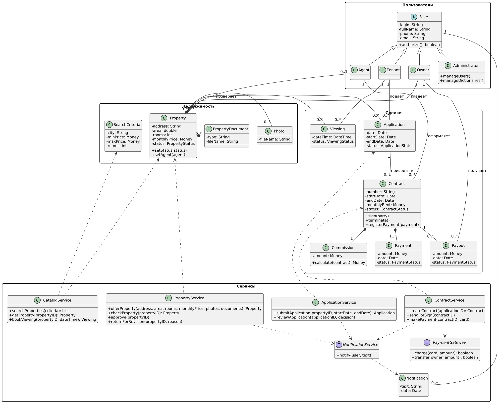
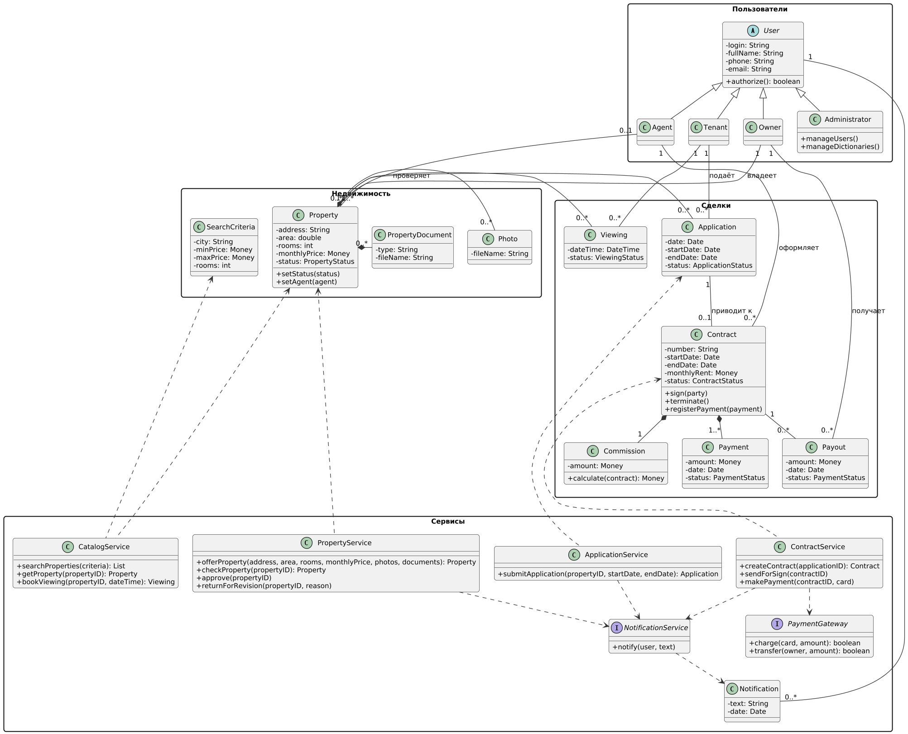

# Диаграмма классов

Диаграмма классов строится на основе модели предметной области, сценариев прецедентов и диаграмм последовательности. В отличие от модели предметной области здесь показаны программные классы с атрибутами и операциями.

Рис. 1. Диаграмма классов информационной системы JilliBilli

## Размещение классов по пакетам

| Пакет | Состав |
|---|---|
| Пользователи | User (абстрактный), Tenant, Owner, Agent, Administrator |
| Недвижимость | Property, Photo, PropertyDocument, SearchCriteria |
| Сделки | Application, Viewing, Contract, Commission, Payment, Payout |
| Сервисы | CatalogService, ApplicationService, PropertyService, ContractService, интерфейсы PaymentGateway и NotificationService, Notification |

## Сервисы и прецеденты

Каждый сервис реализует системные операции одного прецедента. Названия совпадают с диаграммами последовательности.

| Сервис | Прецедент | Системные операции |
|---|---|---|
| CatalogService | Подбор жилья | searchProperties, getProperty, bookViewing |
| ApplicationService | Подача заявки на аренду | submitApplication |
| PropertyService | Предложение жилья | offerProperty, checkProperty, approve, returnForRevision |
| ContractService | Оформление договора и оплата | createContract, sendForSign, makePayment |

PaymentGateway и NotificationService показаны как интерфейсы: они описывают обращение к внешним системам (платежной системе и сервису уведомлений), реализация которых не входит в анализ.

## Использованные отношения

| Отношение | Где применяется |
|---|---|
| Обобщение (generalization) | Tenant, Owner, Agent и Administrator наследуют абстрактный класс User |
| Композиция | Contract включает Commission и Payment, Property включает Photo и PropertyDocument. Эти объекты не существуют без владельца |
| Ассоциация | Owner владеет Property, Agent проверяет Property и оформляет Contract, Tenant подает Application и записывается на Viewing, Application приводит к Contract, Owner получает Payout, Notification адресовано User |
| Зависимость (dependency) | Сервисы используют классы предметной области, ContractService использует PaymentGateway, сервисы заявок, недвижимости и договоров используют NotificationService |

## Значения статусов

На диаграмме статусы указаны типами атрибутов `status`.

| Тип | Значения | Класс |
|---|---|---|
| PropertyStatus | DRAFT, ON_REVIEW, PUBLISHED, RENTED, WITHDRAWN | Property |
| ApplicationStatus | SUBMITTED, APPROVED, REJECTED, CANCELLED, CONTRACTED | Application |
| ViewingStatus | SCHEDULED, COMPLETED, CANCELLED | Viewing |
| ContractStatus | DRAFT, SIGNED, TERMINATED | Contract |
| PaymentStatus | CREATED, PAID, REJECTED | Payment, Payout |

## Исходный код диаграммы

