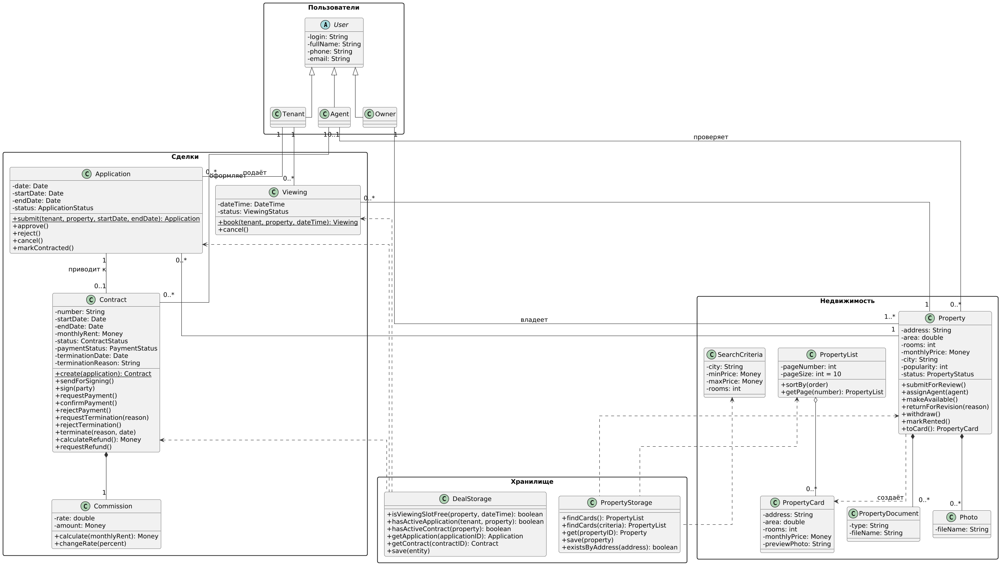

# Диаграмма классов

Диаграмма классов строится на основе модели предметной области и диаграмм последовательности. В отличие от модели предметной области здесь показаны программные классы с атрибутами и операциями. Операция находится в том классе, чьи данные она использует. Платежи, выплаты и возвраты выполняет внешняя платёжная система, поэтому в классах она не показана: она участвует только в диаграммах последовательности.

[Диаграмма классов](image/ДиаграммаКлассов.png)

Рис. 1. Диаграмма классов информационной системы JilliBilli

## Размещение классов по пакетам

|Пакет|Состав|
|---|---|
|Пользователи|User (абстрактный), Tenant, Owner, Agent|
|Недвижимость|Property, Photo, PropertyDocument, PropertyCard, PropertyList, SearchCriteria|
|Сделки|Viewing, Application, Contract, Commission|
|Хранилище|PropertyStorage, DealStorage|

## Хранилища

Классы пакета «Хранилище» отвечают за доступ к базе данных: находят, получают, сохраняют объекты и проверяют условия, для которых нужны данные из БД. Бизнес-логики в них нет, она остаётся в классах предметной области.

|Класс|Назначение|Основные операции|
|---|---|---|
|PropertyStorage|Доступ к объектам недвижимости|findCards() возвращает первую страницу из 10 самых популярных карточек, findCards(criteria) выполняет поиск по критериям, get, save, existsByAddress|
|DealStorage|Доступ к просмотрам, заявкам и договорам|isViewingSlotFree, hasActiveApplication, hasActiveContract, getApplication, getContract, save|

## Операции классов и диаграммы последовательности

|Класс|Операции|Диаграмма последовательности|
|---|---|---|
|Property|submitForReview, assignAgent, makeAvailable, returnForRevision, withdraw, markRented, toCard|Размещение жилья, Подбор и аренда жилья|
|PropertyList|sortBy, getPage|Подбор и аренда жилья|
|Viewing|book, cancel|Подбор и аренда жилья|
|Application|submit, approve, reject, cancel, markContracted|Подбор и аренда жилья, Оформление договора и оплата|
|Contract|create, sendForSigning, sign, requestPayment, confirmPayment, rejectPayment, calculateRefund, requestRefund|Оформление договора и оплата, Расторжение договора|
|Contract|requestTermination, rejectTermination, terminate|Расторжение договора|
|Commission|calculate, changeRate|Оформление договора и оплата|

## Использованные отношения

|Отношение|Где применяется|
|---|---|
|Обобщение (generalization)|Tenant, Owner и Agent наследуют абстрактный класс User|
|Композиция|Property включает Photo и PropertyDocument, Contract включает Commission. Эти объекты не существуют без владельца|
|Агрегация|PropertyList состоит из карточек PropertyCard|
|Ассоциация|Owner владеет Property, Agent проверяет Property и оформляет Contract, Tenant подаёт Application и записывается на Viewing, Application приводит к Contract|
|Зависимость (dependency)|Property создаёт PropertyCard, хранилища используют классы предметной области, PropertyStorage использует SearchCriteria|

## Значения статусов

На диаграмме статусы указаны типами атрибутов `status` и `paymentStatus`.

|Тип|Значения|Класс|
|---|---|---|
|PropertyStatus|DRAFT, ON_REVIEW, AVAILABLE, RENTED, WITHDRAWN|Property|
|ApplicationStatus|SUBMITTED, APPROVED, REJECTED, CANCELLED, CONTRACTED|Application|
|ViewingStatus|SCHEDULED, COMPLETED, CANCELLED|Viewing|
|ContractStatus|DRAFT, «На подписании», SIGNED, TERMINATED|Contract|
|PaymentStatus|не оплачен, оплачен, возвращён|Contract|

## Исходный код диаграммы

