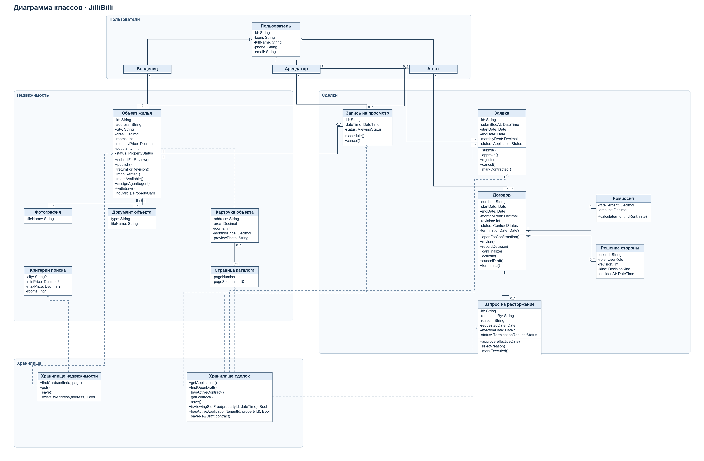
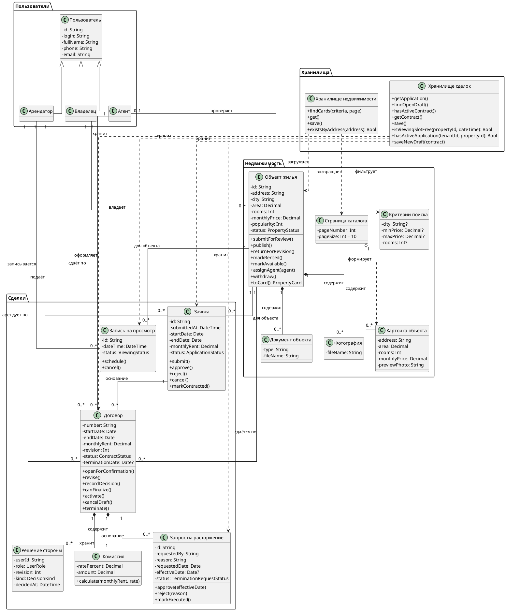

# Диаграмма классов

## Сущности и атрибуты

| Сущность | Обозначение | Ключевые данные |
|---|---|---|
| Владелец | Owner | Роль участника |
| Арендатор | Tenant | Роль участника |
| Агент | Agent | Роль участника |
| Объект жилья | Property | `id: String`, `address: String`, `city: String`, `area: Decimal`, `rooms: Int`, `monthlyPrice: Decimal`, `popularity: Int`, `status: PropertyStatus` |
| Запись на просмотр | Viewing | `id: String`, `dateTime: DateTime`, `status: ViewingStatus` |
| Заявка | Application | `id: String`, `submittedAt: DateTime`, `startDate: Date`, `endDate: Date`, `monthlyRent: Decimal`, `status: ApplicationStatus` |
| Договор | Contract | `number: String`, `startDate: Date`, `endDate: Date`, `monthlyRent: Decimal`, `revision: Int`, `status: ContractStatus`, `terminationDate: Date?` |
| Комиссия | Commission | `ratePercent: Decimal`, `amount: Decimal` |
| Решение стороны | PartyDecision | `userId: String`, `role: UserRole`, `revision: Int`, `kind: DecisionKind`, `decidedAt: DateTime` |
| Запрос на расторжение | TerminationRequest | `id: String`, `requestedBy: String`, `reason: String`, `requestedDate: Date`, `effectiveDate: Date?`, `status: TerminationRequestStatus` |
| Пользователь | User | `id: String`, `login: String`, `fullName: String`, `phone: String`, `email: String` |
| Хранилище сделок | DealStorage | просмотры, заявки, договоры |
| Хранилище недвижимости | PropertyStorage | объекты и каталог |
| Критерии поиска | SearchCriteria | `city: String?`, `minPrice: Decimal?`, `maxPrice: Decimal?`, `rooms: Int?` |
| Карточка объекта | PropertyCard | `address: String`, `area: Decimal`, `rooms: Int`, `monthlyPrice: Decimal`, `previewPhoto: String` |
| Страница каталога | PropertyList | `pageNumber: Int`, `pageSize: Int = 10` |
| Фотография | Photo | `fileName: String` |
| Документ объекта | PropertyDocument | `type: String`, `fileName: String` |

По одной заявке одновременно допускается один незавершённый договор. По объекту допускается один действующий договор. Решения сторон привязаны к редакции, а запросы на расторжение — к действующему договору.

## Ответственность классов

| Класс | Операции |
|---|---|
| Property | submitForReview(), publish(), returnForRevision(), markRented(), markAvailable(), assignAgent(agent), withdraw(), toCard(): PropertyCard |
| Viewing | schedule(), cancel() |
| Application | submit(), approve(), reject(), cancel(), markContracted() |
| Contract | openForConfirmation(), revise(), recordDecision(), canFinalize(), activate(), cancelDraft(), terminate() |
| Commission | calculate(monthlyRent, rate) |
| TerminationRequest | approve(effectiveDate), reject(reason), markExecuted() |
| DealStorage | getApplication(), findOpenDraft(), hasActiveContract(), getContract(), save(), isViewingSlotFree(propertyId, dateTime): Bool, hasActiveApplication(tenantId, propertyId): Bool, saveNewDraft(contract) |
| PropertyStorage | findCards(criteria, page), get(), save(), existsByAddress(address): Bool |

Хранилище сделок содержит заявки, просмотры, договоры и запросы. Хранилище недвижимости отвечает за карточки и доступность жилья. При оформлении и вступлении расторжения в силу согласованные изменения сохраняются неделимо.

## Как связаны объекты и хранилища

- Объект жилья — основная запись с адресом, ценой и статусом. Фотографии и документы относятся к этой записи. Карточка показывает данные объекта в каталоге.
- Критерии поиска — выбранные арендатором фильтры. Хранилище недвижимости подбирает по ним жильё. Страница каталога — результат поиска с набором карточек.
- Хранилище сделок работает с просмотрами, заявками, договорами и запросами на расторжение.
- При завершении оформления ИС повторно проверяет доступность жилья и одним действием сохраняет статусы договора, заявки и объекта.

## Статусы и значения

| Тип | Значения |
|---|---|
| PropertyStatus | Draft — Черновик, OnReview — На проверке, Available — Доступен, Rented — Сдан, Withdrawn — Снят с предложения |
| ApplicationStatus | Submitted — Подана, Approved — Одобрена, Rejected — Отклонена, Cancelled — Отменена, Contracted — Оформлена |
| ViewingStatus | Booked — Запланирован, Cancelled — Отменён |
| ContractStatus | Draft — Черновик, PendingConfirmation — На подтверждении, Active — Действует, Cancelled — Аннулирован, Terminated — Расторгнут |
| TerminationRequestStatus | Submitted — Подан, Approved — Одобрен, Rejected — Отклонён, Executed — Исполнен |
| DecisionKind | Confirmed — Подтверждение, Declined — Отказ |
| UserRole | Agent — Агент, Tenant — Арендатор, Owner — Владелец |

Публикация переводит объект в статус «Доступен». В сценариях исходного архива этому соответствует «Опубликован».

Ставка комиссии по умолчанию хранится в настройке агентства defaultCommissionRatePercent. В Commission сохраняется ставка, применённая в данном договоре.

## Исходный код диаграммы

