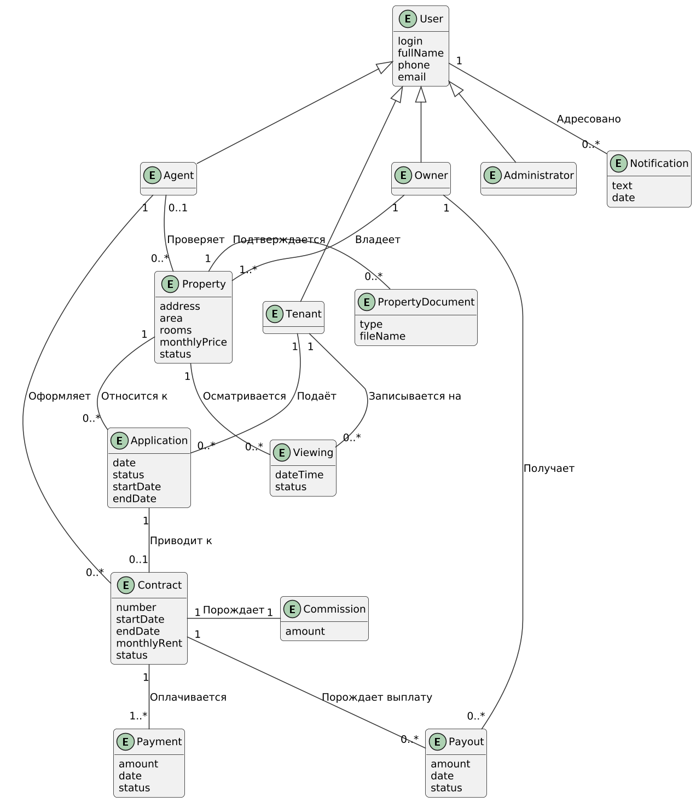
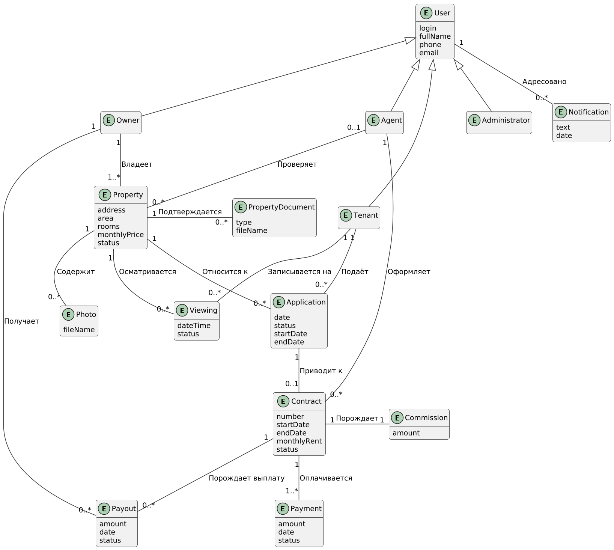

Модель предметной области представляет классы понятий реального мира, а не программные компоненты. Это не набор диаграмм, описывающих программные классы или программные объекты с их обязанностями.
## Описание понятий

Названия понятий на диаграмме и в прецедентах (сценарии, диаграммы последовательности, описания операций) совпадают. Атрибуты указаны на уровне предметной области.

|Понятие|Название на диаграмме|Что это|Атрибуты|Где используется (прецеденты)|
|---|---|---|---|---|
|Пользователь|User|Любой человек, работающий с системой. Является обобщением для ролей Tenant, Owner, Agent, Administrator|login, fullName, phone, email|Зарегистрироваться, Авторизоваться|
|Арендатор|Tenant|Клиент, который ищет и снимает жильё|наследует атрибуты User|Подобрать жильё, Записаться на просмотр, Подать заявку на аренду, Оплатить аренду|
|Владелец жилья|Owner|Собственник, который предлагает жильё и получает выплату за аренду|наследует атрибуты User|Предложить жильё, Снять жильё с предложения, Рассмотреть заявку, Получить выплату|
|Агент|Agent|Сотрудник агентства. Проверяет объекты и документы, оформляет и расторгает договоры|наследует атрибуты User|Проверить объект и документы, Оформить договор, Расторгнуть договор|
|Администратор|Administrator|Сотрудник, управляющий пользователями и справочниками системы|наследует атрибуты User|Управлять пользователями, Управлять справочниками|
|Объект недвижимости|Property|Жильё, которое владелец предлагает к аренде|address (адрес), area (площадь), rooms (число комнат), monthlyPrice (арендная плата в месяц), status (черновик, на проверке, опубликован, сдан, снят)|Предложить жильё, Подобрать жильё, Просмотреть карточку объекта|
|Фотография объекта|Photo|Фотография, которую владелец загружает вместе с предложением жилья и которую арендатор видит в карточке объекта|fileName (имя файла)|Предложить жильё, Просмотреть карточку объекта|
|Документ на объект|PropertyDocument|Документ, подтверждающий право владельца на объект (выписка, договор купли-продажи и т.п.)|type (тип), fileName (имя файла)|Предложить жильё, Проверить объект и документы|
|Заявка на аренду|Application|Обращение арендатора с просьбой сдать ему конкретный объект на заданный срок|date (дата подачи), status (подана, одобрена, отклонена, отменена, оформлена), startDate, endDate (желаемый срок)|Подать заявку на аренду, Рассмотреть заявку, Оформить договор|
|Просмотр|Viewing|Запись арендатора на осмотр объекта в назначенное время|dateTime (дата и время), status (запланирован, состоялся, отменён)|Записаться на просмотр|
|Договор аренды|Contract|Соглашение между арендатором и владельцем, которое оформляет агент|number (номер), startDate, endDate (срок), monthlyRent (арендная плата в месяц), status (черновик, подписан, расторгнут)|Оформить договор, Подписать договор, Расторгнуть договор|
|Комиссия|Commission|Вознаграждение агентства по договору. Рассчитывается по бизнес-правилам|amount (сумма)|Оформить договор, Рассчитать комиссию|
|Платёж|Payment|Платёж арендатора по договору (первый платёж и комиссия, затем ежемесячные)|amount (сумма), date (дата), status (создан, оплачен, отклонён)|Оплатить аренду, Обработать отказ в платеже|
|Выплата|Payout|Перевод владельцу полученной арендной платы за вычетом комиссии|amount (сумма), date (дата), status (создана, выполнена, ошибка)|Получить выплату|
|Уведомление|Notification|Сообщение участнику сделки о событии (новая заявка, подпись договора, платёж)|text (текст), date (дата отправки)|Отправить уведомление|

## Связи между понятиями

|Связь|Кратность|Пояснение|
|---|---|---|
|Owner владеет Property|1 – 1..*|У владельца один или несколько объектов, у объекта один владелец|
|Property содержит Photo|1 – 0..*|У объекта может быть несколько фотографий|
|Property подтверждается PropertyDocument|1 – 0..*|К объекту могут быть приложены документы|
|Agent проверяет Property|0..1 – 0..*|Объект проверяет один агент, агент проверяет много объектов|
|Tenant подаёт Application|1 – 0..*|Арендатор может подать несколько заявок|
|Application относится к Property|0..* – 1|Заявка подаётся на один объект|
|Tenant записывается на Viewing|1 – 0..*|Арендатор может записаться на несколько просмотров|
|Viewing осматривается Property|0..* – 1|Просмотр относится к одному объекту|
|Application приводит к Contract|1 – 0..1|По одобренной заявке оформляется не более одного договора|
|Agent оформляет Contract|1 – 0..*|Договор оформляет один агент|
|Contract порождает Commission|1 – 1|По каждому договору рассчитывается одна комиссия|
|Contract оплачивается Payment|1 – 1..*|По договору проходит один или несколько платежей|
|Contract порождает Payout|1 – 0..*|Выплаты владельцу по договору|
|Owner получает Payout|1 – 0..*|Владелец получает выплаты|
|Notification адресовано User|0..* – 1|Уведомление отправляется одному пользователю|

## Исходный код диаграммы

