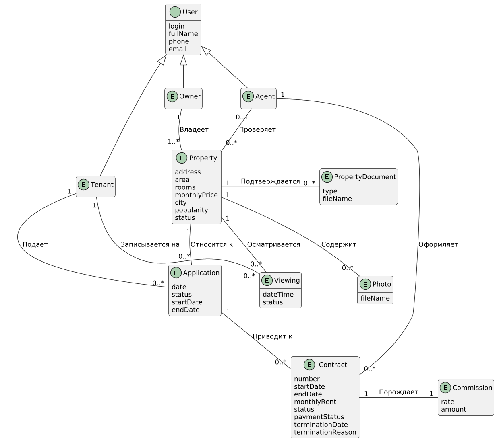

Модель предметной области представляет классы понятий реального мира, а не программные компоненты. Это не набор диаграмм, описывающих программные классы или программные объекты с их обязанностями.

## Описание понятий

Названия понятий на диаграмме и в прецедентах (сценарии, диаграммы последовательности, описания операций) совпадают. Атрибуты указаны на уровне предметной области. Платежи, выплаты и возвраты выполняет внешняя платежная система, поэтому в модели их нет: в договоре хранится только статус оплаты и комиссия. [Модель предметной области](image/МодельПредметОбласть.png)

|Понятие|Название на диаграмме|Что это|Атрибуты|Где используется (прецеденты)|
|---|---|---|---|---|
|Пользователь|User|Любой человек, работающий с системой. Является обобщением для ролей Tenant, Owner, Agent|login, fullName, phone, email|Все прецеденты|
|Арендатор|Tenant|Клиент, который ищет и снимает жильё|наследует атрибуты User|Подбор и аренда жилья, Оформление договора и оплата, Расторжение договора|
|Владелец жилья|Owner|Собственник, который предлагает жильё и получает арендную плату в полном размере|наследует атрибуты User|Размещение жилья, Подбор и аренда жилья, Оформление договора и оплата, Расторжение договора|
|Агент|Agent|Сотрудник агентства. Проверяет объекты и документы, оформляет и расторгает договоры|наследует атрибуты User|Размещение жилья, Оформление договора и оплата, Расторжение договора|
|Объект недвижимости|Property|Жильё, которое владелец предлагает к аренде|address (адрес), area (площадь), rooms (число комнат), monthlyPrice (арендная плата в месяц), city (город), popularity (популярность), status (черновик, на проверке, доступен, сдан, снят)|Размещение жилья, Подбор и аренда жилья, Расторжение договора|
|Фотография объекта|Photo|Фотография, которую владелец загружает вместе с предложением жилья и которую арендатор видит в карточке объекта|fileName (имя файла)|Размещение жилья, Подбор и аренда жилья|
|Документ на объект|PropertyDocument|Документ, подтверждающий право владельца на объект (выписка, договор купли-продажи и т.п.)|type (тип), fileName (имя файла)|Размещение жилья|
|Заявка на аренду|Application|Обращение арендатора с просьбой сдать ему конкретный объект на заданный срок|date (дата подачи), status (подана, одобрена, отклонена, отменена, оформлена), startDate, endDate (желаемый срок)|Подбор и аренда жилья, Оформление договора и оплата|
|Просмотр|Viewing|Запись арендатора на осмотр объекта в назначенное время|dateTime (дата и время), status (запланирован, состоялся, отменён)|Подбор и аренда жилья|
|Договор аренды|Contract|Соглашение между арендатором и владельцем, которое оформляет агент|number (номер), startDate, endDate (срок), monthlyRent (арендная плата в месяц), status (черновик, на подписании, подписан, аннулирован, расторгнут), paymentStatus (не оплачен, оплачен, возвращён), terminationDate (дата расторжения), terminationReason (причина расторжения)|Оформление договора и оплата, Расторжение договора|
|Комиссия|Commission|Вознаграждение агентства по договору. Рассчитывается по бизнес-правилам, платит арендатор|rate (ставка), amount (сумма)|Оформление договора и оплата|

## Связи между понятиями

|Связь|Кратность|Пояснение|
|---|---|---|
|Owner владеет Property|1 – 1..*|У владельца один или несколько объектов, у объекта один владелец|
|Property содержит Photo|1 – 0..*|У объекта может быть несколько фотографий|
|Property подтверждается PropertyDocument|1 – 0..*|К объекту могут быть приложены документы|
|Agent проверяет Property|0..1 – 0..*|Объект проверяет один агент, агент проверяет много объектов|
|Tenant подаёт Application|1 – 0..*|Арендатор может подать несколько заявок|
|Application относится к Property|0..* – 1|Заявка подаётся на один объект|
|Tenant записывается на Viewing|1 – 0..*|Арендатор может записаться на несколько просмотров|
|Viewing осматривается Property|0..* – 1|Просмотр относится к одному объекту|
|Application приводит к Contract|1 – 0..*|По заявке может быть оформлено несколько договоров (например, после аннулирования черновика), но действует не более одного|
|Agent оформляет Contract|1 – 0..*|Договор оформляет один агент|
|Contract порождает Commission|1 – 1|По каждому договору рассчитывается одна комиссия|

## Исходный код диаграммы

