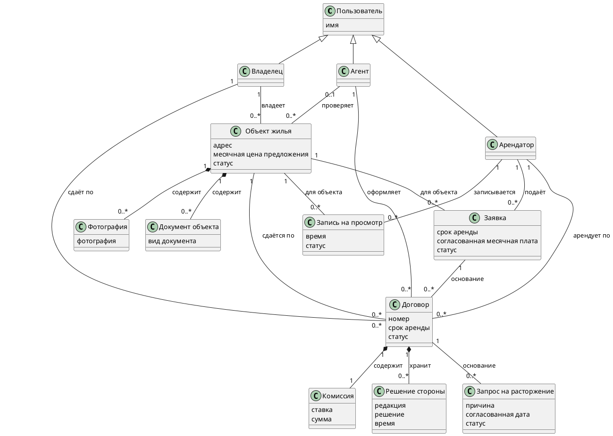

# Модель предметной области

## Сущности и атрибуты

| Сущность | Обозначение | Ключевые данные |
|---|---|---|
| Пользователь | User | имя |
| Фотография | Photo | фотография |
| Документ объекта | PropertyDocument | вид документа |
| Владелец | Owner | Роль участника |
| Арендатор | Tenant | Роль участника |
| Агент | Agent | Роль участника |
| Объект жилья | Property | адрес, месячная цена предложения, статус |
| Запись на просмотр | Viewing | время, статус |
| Заявка | Application | срок аренды, согласованная месячная плата, статус |
| Договор | Contract | номер, срок аренды, статус |
| Комиссия | Commission | ставка, сумма |
| Решение стороны | PartyDecision | редакция, решение, время |
| Запрос на расторжение | TerminationRequest | причина, согласованная дата, статус |

По одной заявке одновременно допускается один незавершённый договор. По объекту допускается один действующий договор. Решения сторон привязаны к редакции, а запросы на расторжение — к действующему договору.

## Исходный код диаграммы

