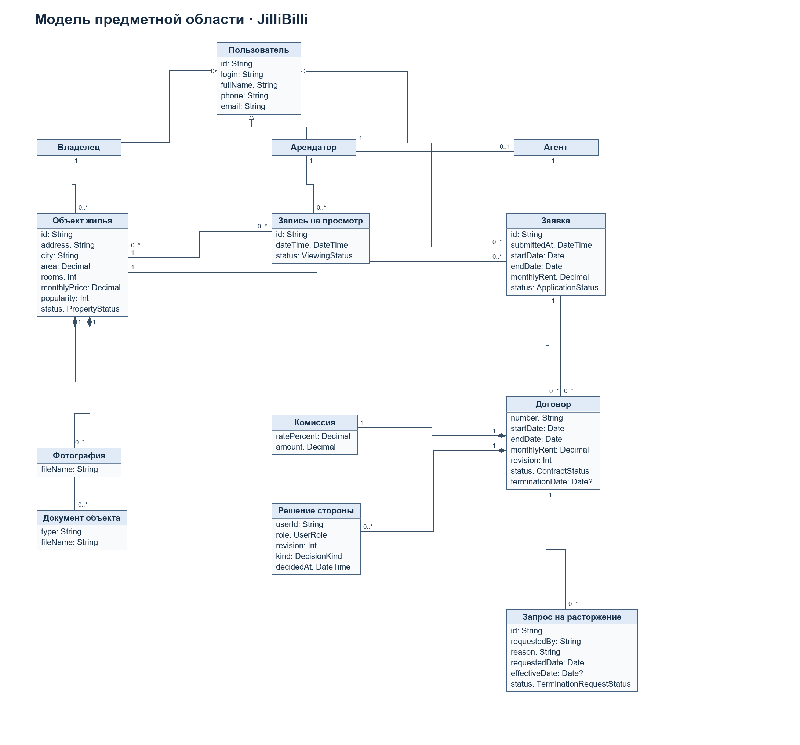
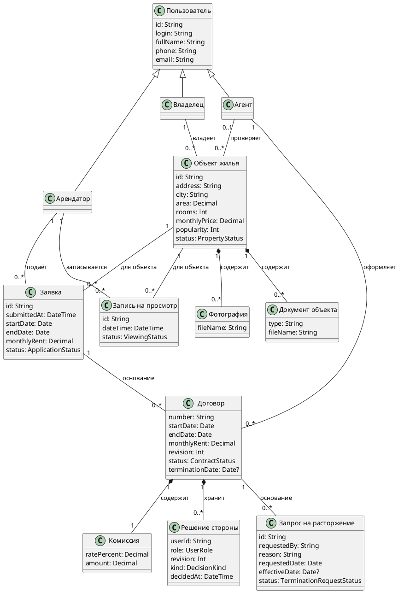

# Модель предметной области

## Сущности и атрибуты

| Сущность | Обозначение | Ключевые данные |
|---|---|---|
| Владелец | Owner | Роль участника |
| Арендатор | Tenant | Роль участника |
| Агент | Agent | Роль участника |
| Объект жилья | Property | `id: String`, `address: String`, `city: String`, `area: Decimal`, `rooms: Int`, `monthlyPrice: Decimal`, `popularity: Int`, `status: PropertyStatus` |
| Запись на просмотр | Viewing | `id: String`, `dateTime: DateTime`, `status: ViewingStatus` |
| Заявка | Application | `id: String`, `submittedAt: DateTime`, `startDate: Date`, `endDate: Date`, `monthlyRent: Decimal`, `status: ApplicationStatus` |
| Договор | Contract | `number: String`, `startDate: Date`, `endDate: Date`, `monthlyRent: Decimal`, `revision: Int`, `status: ContractStatus`, `terminationDate: Date?` |
| Комиссия | Commission | `ratePercent: Decimal`, `amount: Decimal` |
| Решение стороны | PartyDecision | `userId: String`, `role: UserRole`, `revision: Int`, `kind: DecisionKind`, `decidedAt: DateTime` |
| Запрос на расторжение | TerminationRequest | `id: String`, `requestedBy: String`, `reason: String`, `requestedDate: Date`, `effectiveDate: Date?`, `status: TerminationRequestStatus` |

По одной заявке одновременно допускается один незавершённый договор. По объекту допускается один действующий договор. Решения сторон привязаны к редакции, а запросы на расторжение — к действующему договору.

## Исходный код диаграммы

