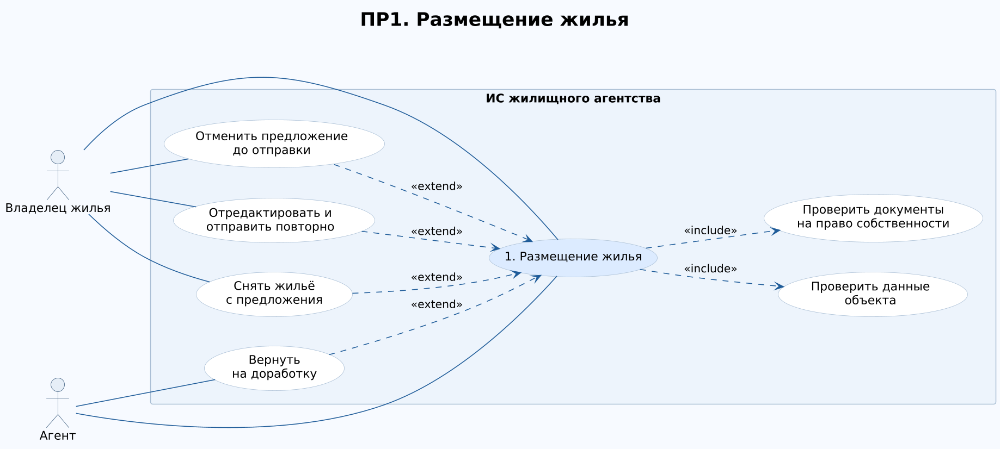
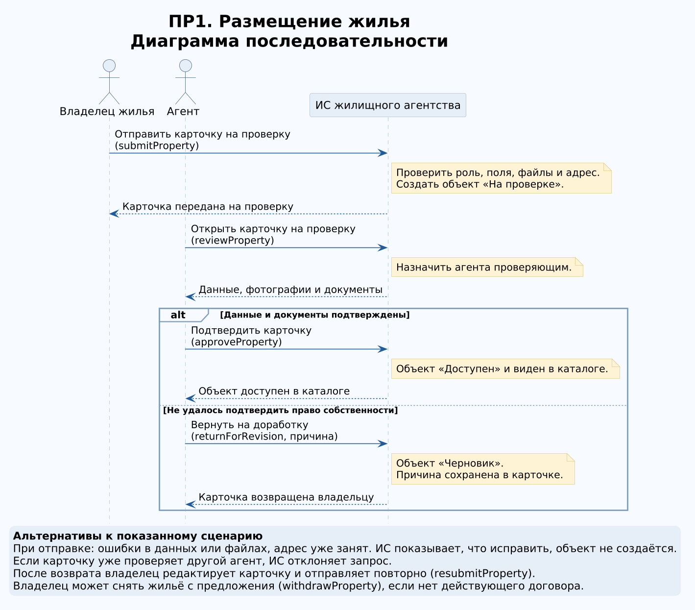
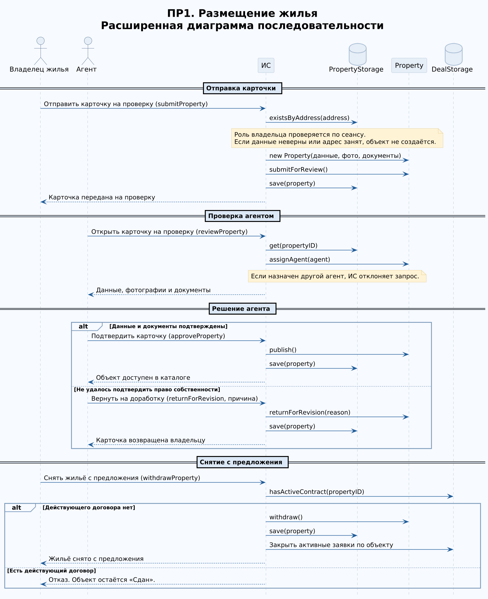

# Исходники диаграмм ПР1

## Контекстная диаграмма

[Изображение](Контекст1.png)

## Диаграмма последовательности

[Изображение](ДиаграммаПослед1.png)

## Расширенная диаграмма последовательности

[Изображение](ДиаграммаПослед1.Расширенная.png)

Операции хранилищ и класса Property взяты из диаграммы классов: `existsByAddress`, `get`, `save`, `hasActiveContract`, `submitForReview`, `assignAgent`, `publish`, `returnForRevision`, `withdraw`.

