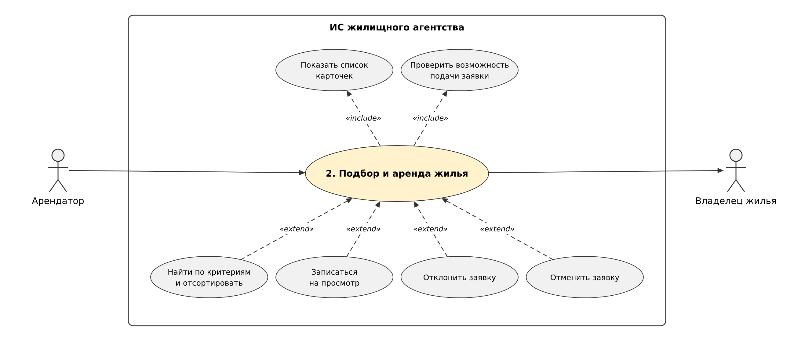
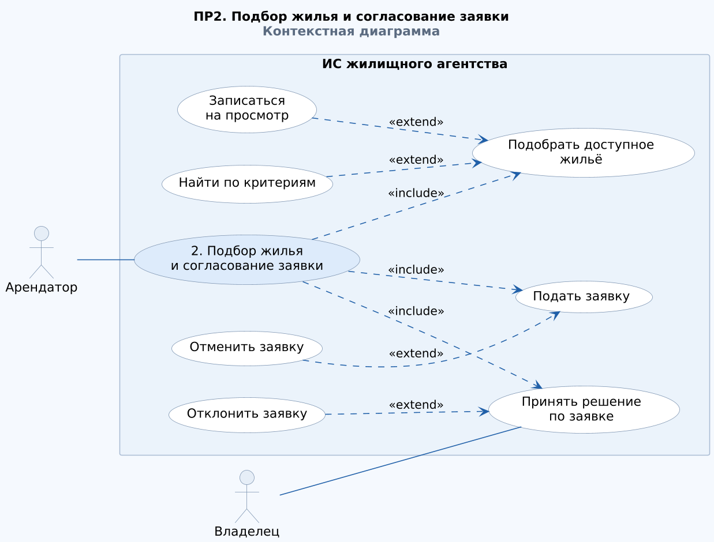
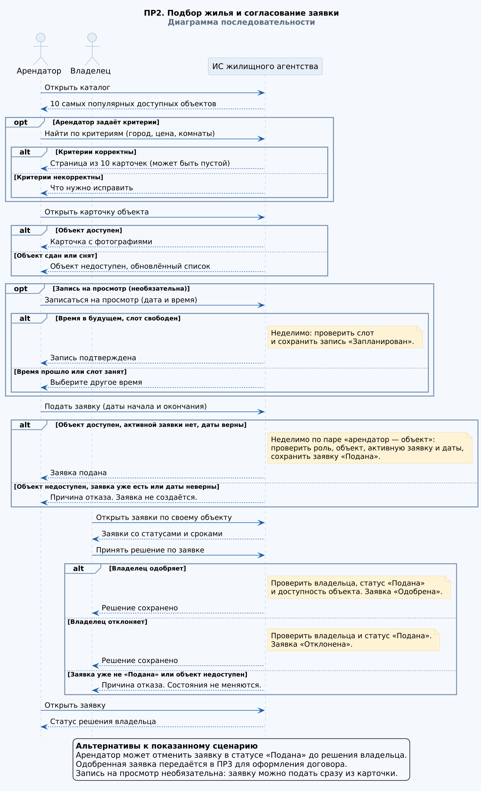
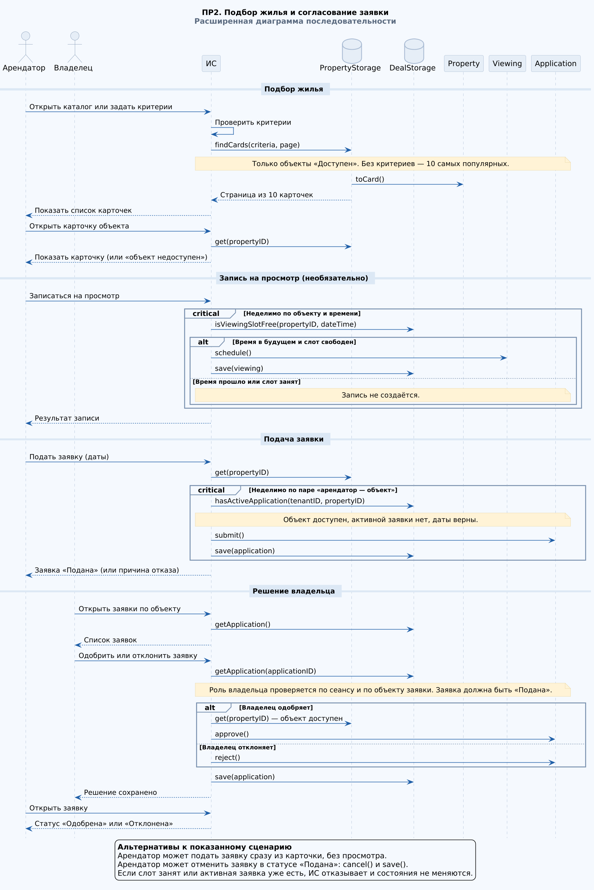
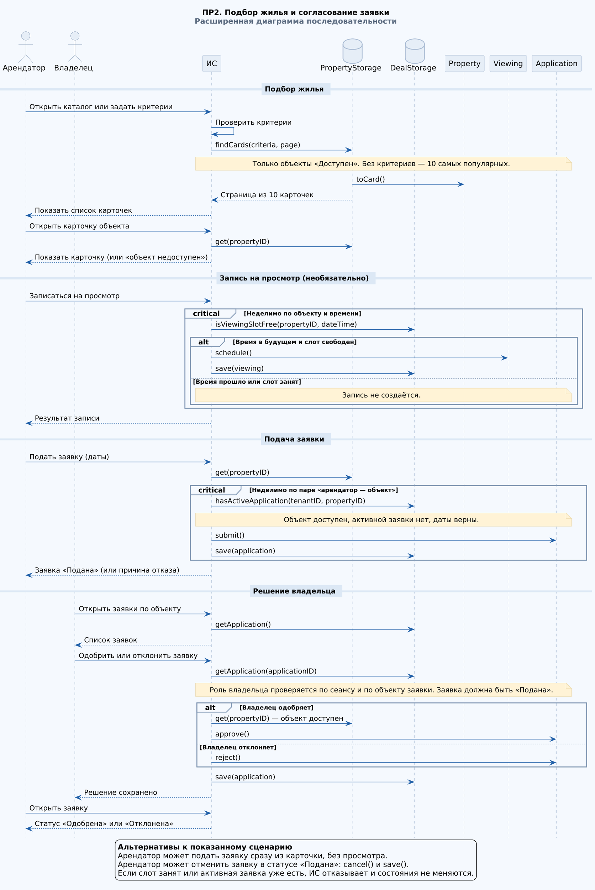

# Исходники диаграмм ПР2

## Контекстная диаграмма

## Диаграмма последовательности

## Расширенная диаграмма последовательности

Оба хранилища участвуют в подборе, записи на просмотр, подаче заявки и решении владельца. Проверка слота и проверка активной заявки выполняются неделимо.

