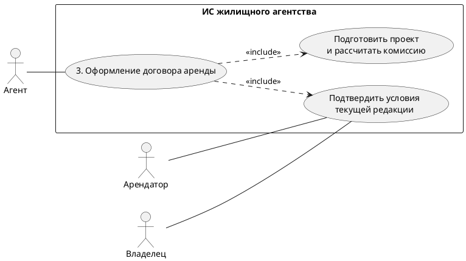
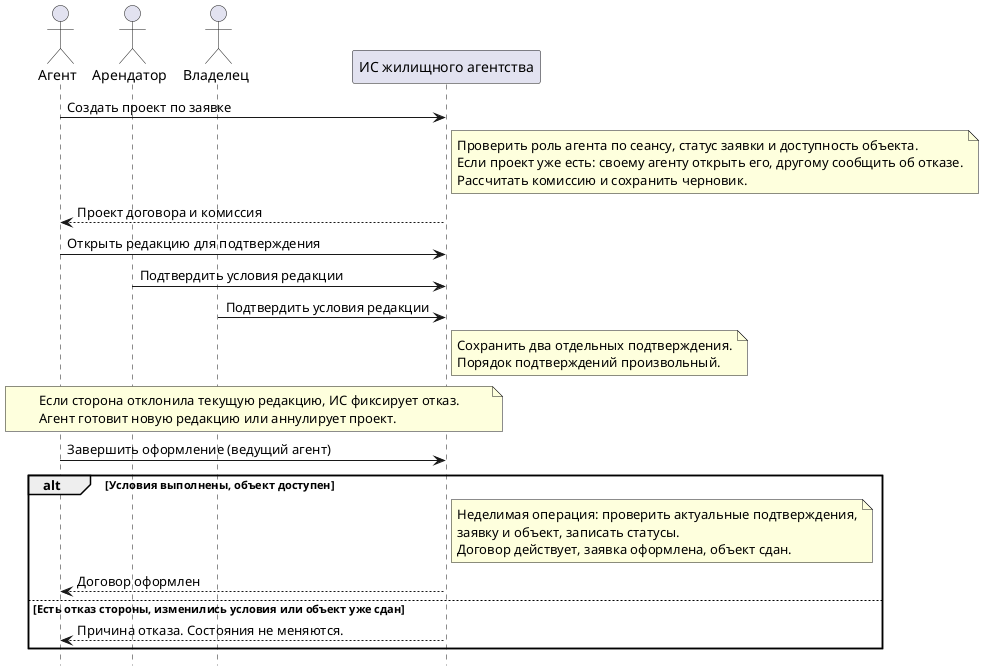
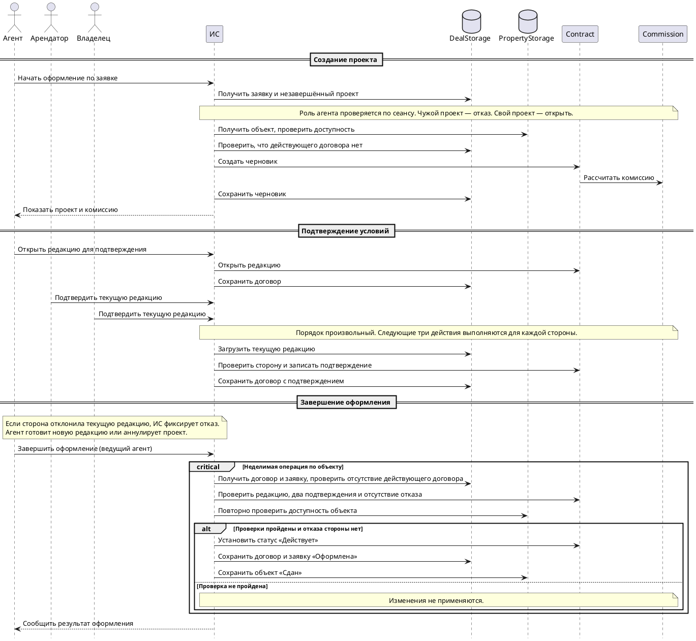

# Исходники диаграмм ПР3

## Контекстная диаграмма

## Диаграмма последовательности

## Расширенная диаграмма последовательности

[Изображение](ДиаграммаПослед3.Расширенная.png)

Оба хранилища участвуют в одной неделимой операции при завершении оформления.

